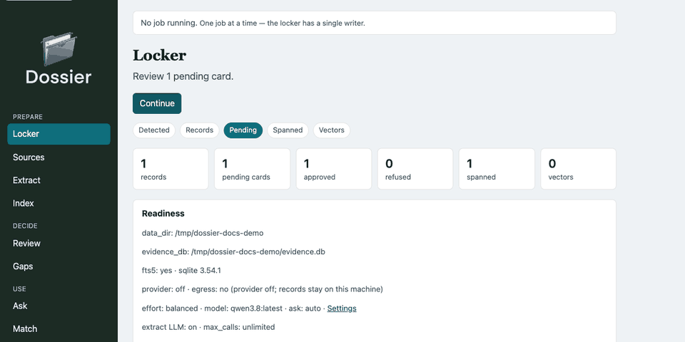
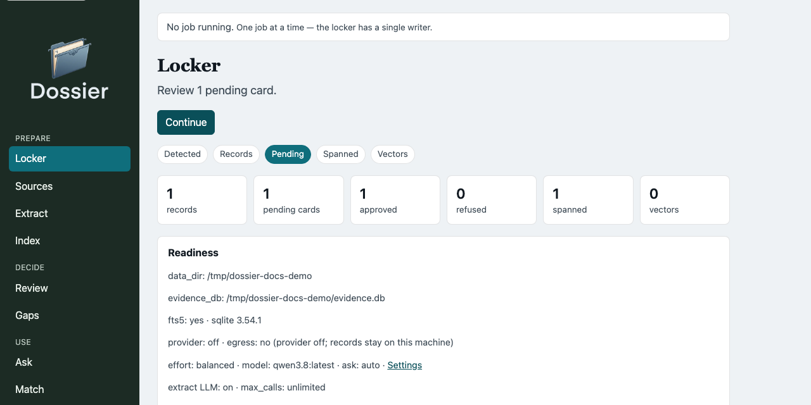
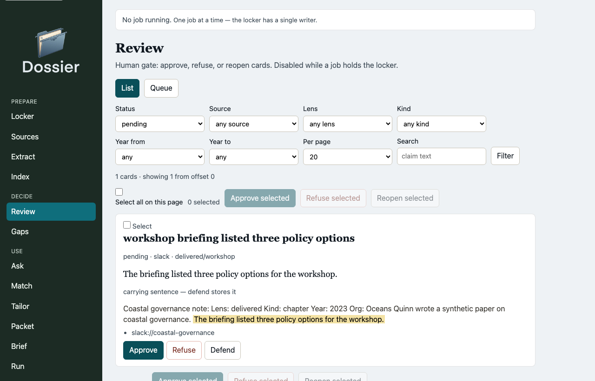
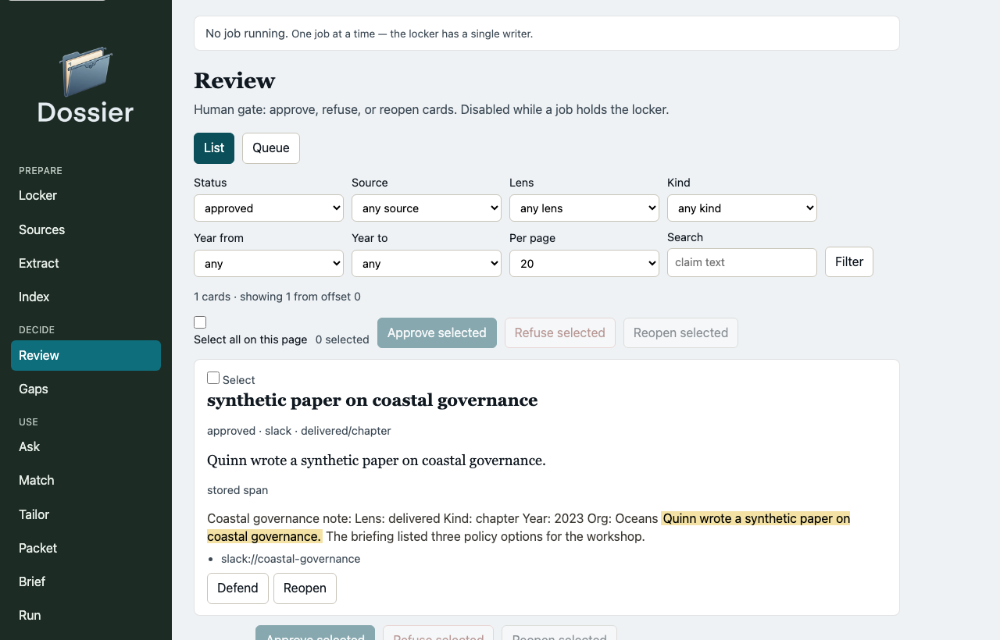
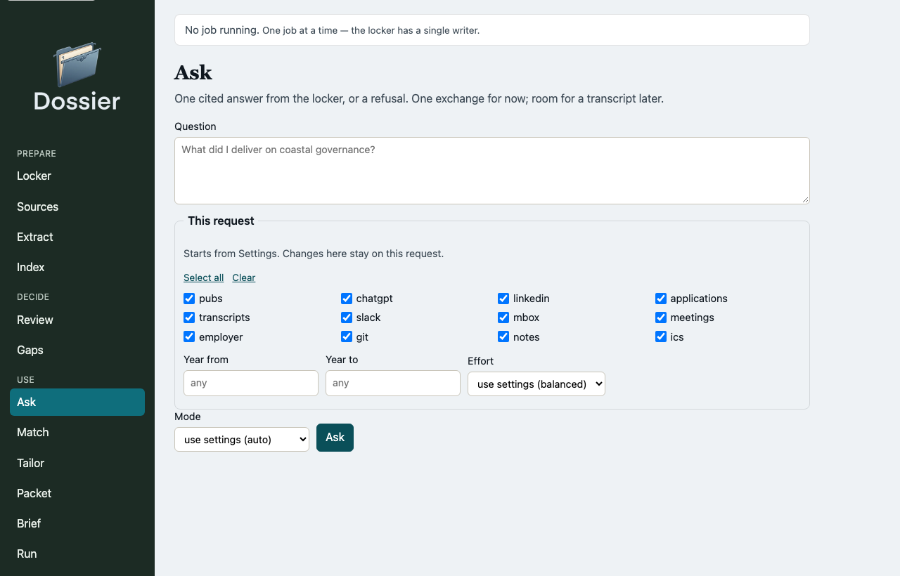
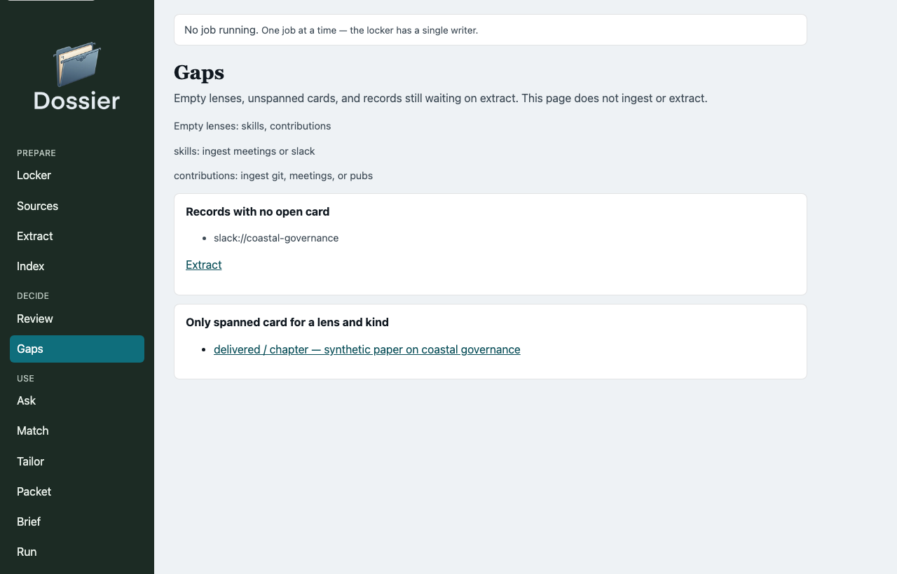
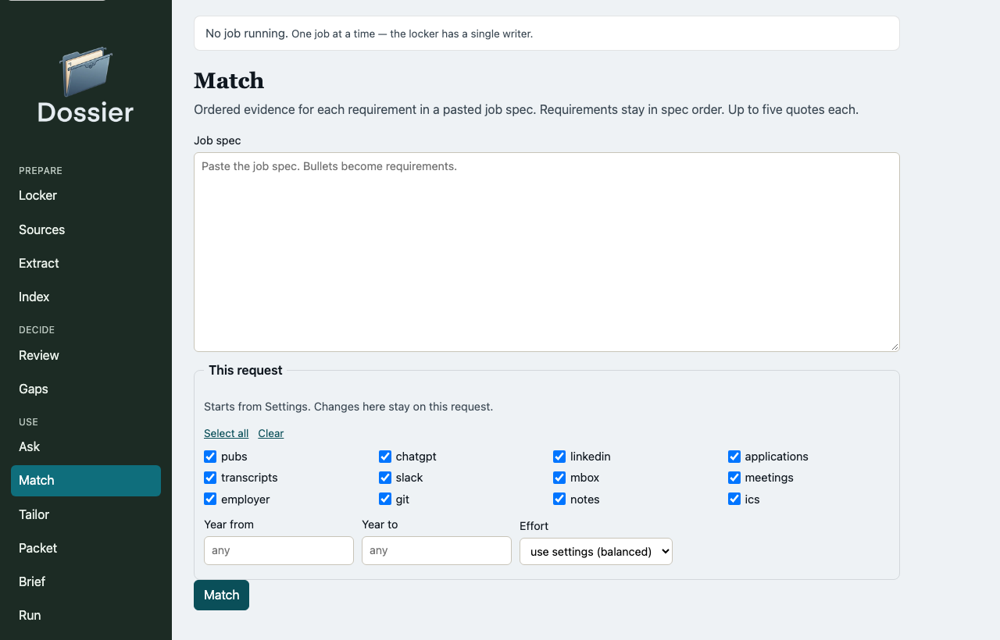
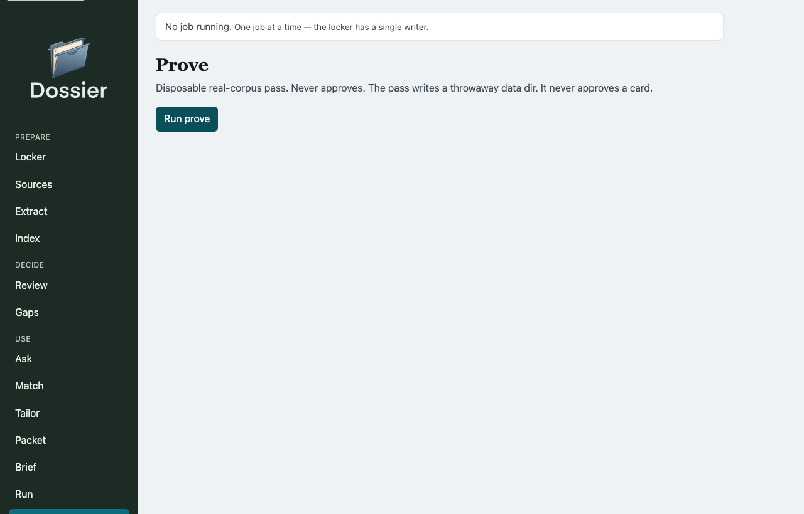
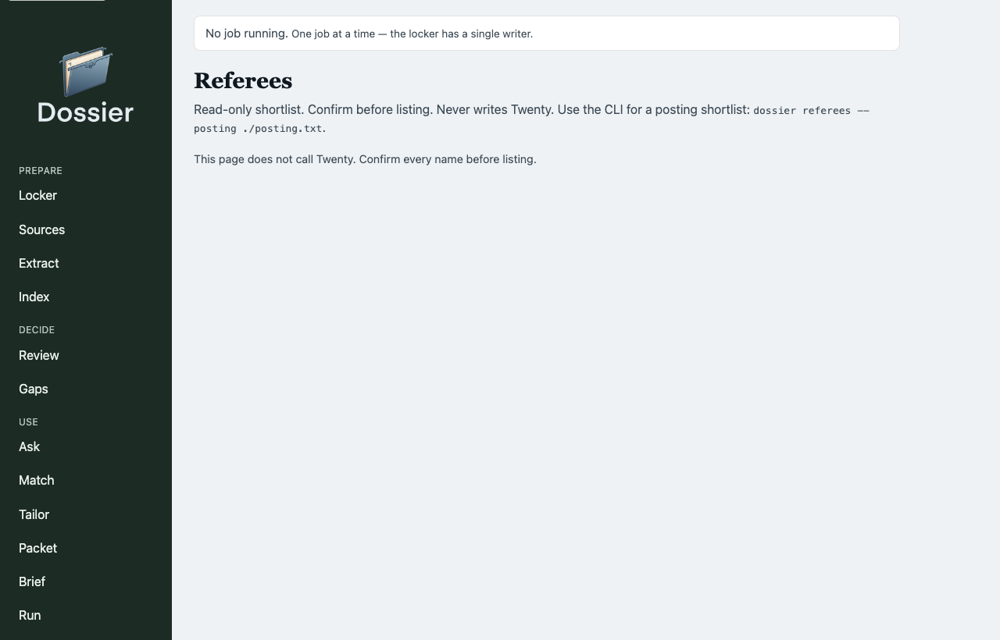

# Workbench

Type: GUIDE
Authority: The loopback GUI (`dossier gui`). Command behaviour lives in [status](status.md). Vocabulary lives in [vocab](vocab.md).

The workbench is the 1.0 daily loop on `127.0.0.1` (`uv sync --extra web`). It is one job at a time: the locker has a single writer. State-changing posts are CSRF-checked. Failed jobs show the error only; tracebacks stay in the server log.

```text
uv sync --extra web
uv run dossier gui          # http://127.0.0.1:8766/
uv run dossier review       # same server, /review
```

Nav is four rooms. Every key is still its own URL.

| Room | Pages |
| --- | --- |
| Prepare | locker, sources, extract, index |
| Decide | review, gaps, drift |
| Use | ask, match, tailor, packet, brief, run, prove, referees |
| Settings | settings (knobs, phrase lists, prompts, packs) |

Screenshots below use a synthetic locker. They are not a personal corpus.

## Loop

Locker names the next step. Review is the human gate. Ask quotes a cited span or refuses.



## Locker

Counts, readiness, and a Continue button to the next stage. `doctor` is the CLI form of the same notes.



## Review

Approve, refuse, reopen, and defend. List or one-card queue. The highlight is the carrying sentence (`SPAN_MAX`, default 320 characters). Defend stores that sentence and does not change status.

Pending:



Approved, with a stored span:



## Ask

Paste a question. Scope (sources, years, effort) stays on that request. The answer streams onto the page when the job finishes. Same refuse rule as `dossier ask`.



## Match, gaps, drift, prove, referees

Match takes a pasted job spec and lists evidence per requirement. Gaps names empty lenses, unspanned cards, and records still waiting on extract; it does not run those commands. Drift lists approved cards marked stale when a cited record's text changed, exact duplicate sentences, and full-walk URIs the last ingest missed; it does not ingest, approve, or delete. Prove and referees are the same read-only passes as the CLI.









Tailor picks markdown, HTML, DOCX, or PDF (PDF needs the `render` extra), can append the cited record URIs, and links the file under `data/drafts/` for download. The download route serves only a file directly inside that folder. Tailor and packet stay their own pages. Match can open Tailor with the same posting; Tailor stays off the Match page.

Cancel a running job from the strip at the top. History survives a restart under `$DOSSIER_DATA/jobs/`.
